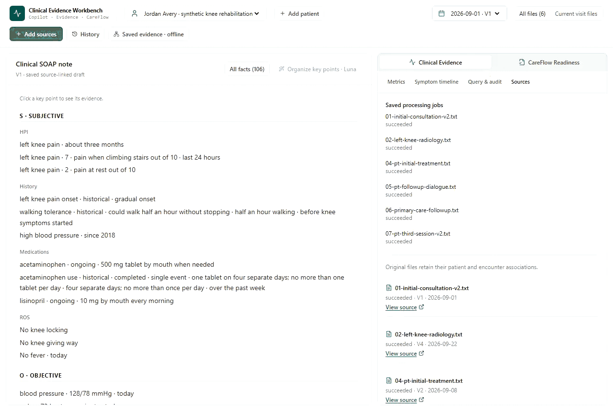

# Clinical Evidence Workbench

**Turn scattered clinical notes into answers you can trace back to the record.**

A patient story is spread across conversations, imaging, therapy notes and forms. A readable note alone cannot tell you which visit established a fact, how a total was calculated, or whether a referral or prior authorization packet has the required documents. Clinical Evidence Workbench keeps the extracted fact, its encounter and its exact source passage together, then uses that record across two products: **Clinical Evidence Copilot** for SOAP and longitudinal questions, and **CareFlow Readiness Engine** for documentation checks.

| Question | Answer in the workbench | Source record |
| --- | --- | --- |
| What happened at this visit? | Concise SOAP key points for the selected encounter. | Click a point to see its supporting passage, then open the full original file below. |
| How much physical therapy is documented? | **40 + 45 = 85 minutes**; a third attended session has no recorded duration and is excluded from the total. | Each session, calculation step and missing value links to its source. |
| Is the request ready? | The referral checklist is complete; the PA view identifies the remaining prior-therapy requirement. | Open each received material and the clinical evidence behind the requirement. |

The workbench also follows recorded symptoms across visits, so a trend can be inspected against individual notes rather than inferred from a summary.



[Watch the full walkthrough](docs/showcase-case-20261016/media/workbench-walkthrough.mp4) · [Explore the patient and original files](docs/showcase-case-20261016/README.md)

## How it works

**GPT-6 Luna** powers the complete workflow shown here. This lightweight general-purpose model captures the main clinical story across notes and conversations. Whether a specialized clinical model improves extraction requires separate evaluation.

**Luna extracts each clinical file once.** The workbench stores structured facts with encounter identity and exact references. Copilot projects those facts into SOAP key points and answers cross-file questions; CareFlow combines the same evidence with received referral and PA materials. Preset calculations and material checks run from saved evidence, without re-extracting the documents. A correction creates a versioned fact revision so dependent answers can be recalculated.

The [synthetic showcase](docs/showcase-case-20261016/README.md) contains **eight original files across five visits**. Luna processed each of the **six clinical files once**; two formal documents entered through material intake. The saved run demonstrates the 85-minute known subtotal with one missing duration, encounter-specific SOAP, recorded symptom changes, and the referral and PA checks above. [Inspect the requests, responses and results](docs/showcase-case-20261016/metrics-and-results.json).

**About four cents to extract the six-file showcase.** The six saved Luna requests used **122,926 input + 56,175 output tokens** (179,101 total), equivalent to **$0.0404** at [GPT-6 Luna Standard API rates](https://developers.openai.com/api/docs/models/gpt-6-luna) on October 16, 2026: $0.10/M input and $0.50/M output. That averages **$0.0067 per clinical file**. The demonstrated SOAP views, preset queries and readiness recalculation reuse saved evidence with no additional model calls. [Per-request tokens and cost breakdown](docs/showcase-case-20261016/metrics-and-results.json) records the API-equivalent estimate from the saved Codex usage.

**Ask in your own words** can explicitly use Luna to interpret a question before calculation. **Organize key points** can explicitly use Luna to order selected saved statements. The underlying clinical facts remain linked to their original sources. “Ready” means the project-defined documentation checklist is complete; it does not mean insurer approval.

## Run it

On Windows with Python 3.12, start the live-input workbench. The compiled frontend is included.

```powershell
python -m venv .venv
.\.venv\Scripts\python.exe -m pip install -r clinical-evidence-copilot/requirements.lock
.\start-products.ps1
```

Open **http://127.0.0.1:8857/workbench/**. The default connection uses the authenticated local Codex CLI with `gpt-6-luna`. Create a patient, upload UTF-8 notes or dialogues, assign encounters and extract. You can use the [eight original showcase files](docs/showcase-case-20261016/synthetic-knee-showcase-sources.zip) to follow the demonstrated case.

To use the OpenAI API, set the key in the server environment and select its provider:

```powershell
$apiSecret = Read-Host 'OpenAI API key' -AsSecureString
$env:OPENAI_API_KEY = [System.Net.NetworkCredential]::new('', $apiSecret).Password
.\start-products.ps1 -Provider openai_api
```

`-Check` verifies local configuration without a model request. The [API connector validation](docs/showcase-case-20261016/api/VALIDATION.md) records its tested boundaries.

To inspect the showcase immediately, run `.\start-products.ps1 -SavedCase`. This restores the original files and actual saved Luna responses without issuing a new extraction request; use the normal command above for live extraction.

[Selected reports and evidence](docs/REPORTS.md) · [HTTP interface](docs/patient-workbench/API.md) · [Frontend development](clinical-evidence-copilot/frontend/workbench/README.md)

[Project history](docs/HISTORY.md)

## Medical use and license

**Clinical outputs are supporting drafts and evidence summaries.** A qualified
healthcare professional must independently review the original sources and relevant
patient context before using outputs for diagnosis, treatment, medication or any
other substantive patient-care decision. CareFlow checks documentation completeness;
it does not decide medical necessity, insurance approval or final authorization.
No clinical validation, regulatory approval or compliance certification is claimed.
See [medical-use guidance](MEDICAL_USE.md).

Original project code and documentation are open source under the standard
[Apache License 2.0](LICENSE.md), including commercial use subject to its terms.
Third-party libraries, datasets, terminology and model resources retain their own
licenses and applicable agreements. See [NOTICE](NOTICE) and
[third-party notices](THIRD_PARTY_NOTICES.md).
Medical-use guidance does not add a condition to the Apache license.

Contact: [theveridislion@duck.com](mailto:theveridislion@duck.com).
